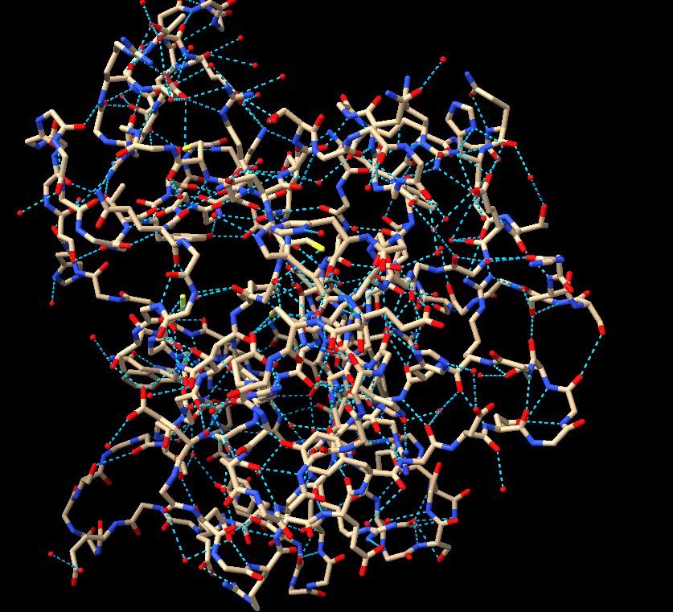
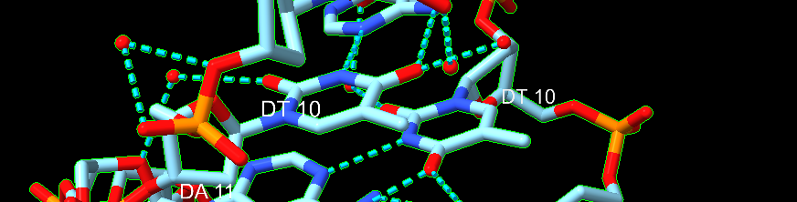
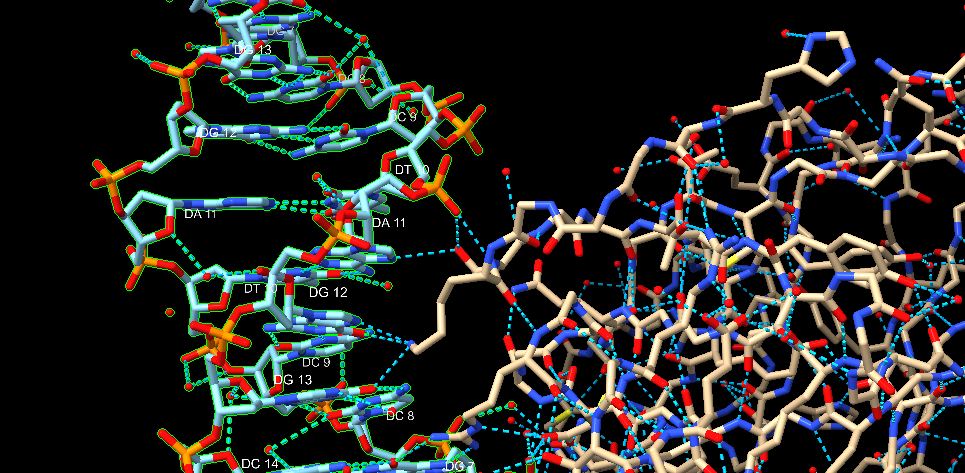
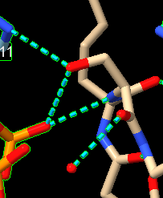

# Scientist’s Mission
**Who Stole TP53’s Superpower? Searching for the Key to Unlock Cancer**  
*Using AI to Uncover the Secrets of TP53–DNA Interactions*

---

## 1. 【The LEGO Assembly Line】
**Question:**
What type of bond links amino acids together to form a protein? Which amino acids form hydrogen bonds with each other?

**Answer:**
* **連結鍵結：** Peptide bond（肽鍵）。
* **形成氫鍵的胺基酸：**
  * **主鏈（Backbone）：** 所有胺基酸的主鏈羰基（C=O）與亞氨基（N-H）之間皆可形成氫鍵，藉此構成蛋白質的二次結構（$lpha$-螺旋與 $eta$-摺疊）。
  * **側鏈（Side chain）：** 具有極性（Polar）或帶電（Charged）側鏈的胺基酸可彼此形成氫鍵，包含：
    * **帶極性羥基/醯胺基：** Serine (Ser), Threonine (Thr), Tyrosine (Tyr), Asparagine (Asn), Glutamine (Gln)
    * **帶電酸性/鹼性：** Aspartic acid (Asp), Glutamic acid (Glu), Lysine (Lys), Arginine (Arg), Histidine (His)

---

## 2. 【The Double-Track Highway of Life’s Blueprint】
**Question:**
How do nucleotides assemble to form double-stranded DNA? What are the basic structural components of DNA? Is DNA right-handed or left-handed? List the names of the four DNA bases. Which bases form hydrogen bonds with each other?

**Answer:**
* **核苷酸如何組裝成雙股 DNA：** 單股 DNA 內的核苷酸透過磷酸二酯鍵（Phosphodiester bonds）連接成去氧核糖-磷酸骨架（Sugar-phosphate backbone）；兩股互補的 DNA 單股則透過鹼基之間的氫鍵（Hydrogen bonds）反向平行（Anti-parallel）組合為雙螺旋結構。
* **DNA 的基本組成成分：** 包含三個基本部分：
  1. 去氧核糖（Deoxyribose sugar）
  2. 磷酸基團（Phosphate group）
  3. 含氮鹼基（Nitrogenous base）
* **DNA 螺旋方向：** Right-handed（右旋，最常見的 B-DNA 形式）。
* **四大 DNA 鹼基名稱：**
  * Adenine (A) - 腺嘌呤
  * Thymine (T) - 胸腺嘧啶
  * Cytosine (C) - 胞嘧啶
  * Guanine (G) - 鳥嘌呤
* **彼此形成氫鍵的鹼基配對（Chargaff 配對規則）：**
  * A 與 T 形成 2 個氫鍵（A = T）
  * C 與 G 形成 3 個氫鍵（C ≡ G）

---

## 3. 【Searching for My One-and-Only Soulmate in the Universe: A 20-Base-Pair Love Code Hidden Among 3 Billion DNA Base Pairs】
**Question:**
The source of molecular stability and specificity: hydrogen bonding — How do TP53 and DNA recognize each other?  
Using the structure 3KMD, identify one pair of an amino acid and a DNA base that interact with each other.

**Answer:**
* **TP53 與 DNA 的辨識機制：** TP53 蛋白透過精確的氫鍵形成與空間互補結構辨識 DNA。其特定胺基酸側鏈會伸入 DNA 的大溝（Major groove）中，與特定含氮鹼基（及磷酸骨架）形成專一性氫鍵。
* **相互作用對範例 (PDB 3KMD)：** **Arg280 (Arginine 280) — Guanine (G)**
  * *說明：* 在 3KMD 結構中，TP53 的 Arg280 側鏈與 DNA 大溝中的 Guanine 鹼基形成專一性的雙重氫鍵（Bidentate hydrogen bonds），確保 TP53 能在 30 億個 DNA 鹼基對中精確定位標的序列。

---

## 4. 【Return to the Crime Scene】
**Question:**
Why can a mutation (change) in just one amino acid of a protein sometimes lead to a serious human disease? Give one specific example of such a disease.

**Answer:**
* **原因：** 單一胺基酸的改變（點突變）可能會破壞蛋白質關鍵的氫鍵、鹽橋或三維結構折疊，改變活性區域的電荷與空間幾何，或是直接干擾蛋白質與 DNA/其他分子的結合能力，導致蛋白質功能喪失或產生毒性聚集。
* **具體疾病範例：** **Sickle Cell Anemia（鐮刀型紅血球貧血症）**
  * *說明：* 由於 $eta$-血紅素基因突變，第 6 位胺基酸由帶電的麩胺酸（Glutamic acid）突變為疏水的纈胺酸（Valine），導致血紅素分子在低氧狀態下異常聚合成纖維狀，使紅血球變形為鐮刀狀並引發血管阻塞與嚴重貧血。

---

## 5. 【Return to the Crime Scene: Searching for Clues】
**Question:**
Using the TP53–DNA structure (3KMD), identify one TP53 amino acid mutation that can lead to uncontrolled cell division and contribute to the development of cancer.  
Then examine this amino acid in ChimeraX. Based on its three-dimensional position, determine whether the mutated amino acid is located directly at the protein–DNA interface or somewhere else in the protein.

**Answer:**
* **TP53 癌化突變範例：** **R273H**（第 273 位點的精胺酸 Arginine 突變為組胺酸 Histidine）或 **R175H**（第 175 位點的精胺酸突變為組胺酸）。
* **位置判定（依選擇的突變點回答）：**
  * **若選擇 R273H (或 R280K, R248Q)：** Located directly at the protein–DNA interface（直接位於蛋白質與 DNA 的結合介面上）。這類突變（Contact mutation）會直接破壞 TP53 與 DNA 帶負電骨架或鹼基之間的氫鍵結合能力。
  * **若選擇 R175H (或 R249S, G245S)：** Located somewhere else in the protein (Structural mutation)（位於蛋白質內部的核心結構區，而非直接與 DNA 接觸）。這類突變會破壞整體蛋白質的幾何結構或鋅離子結合位，間接導致 DNA 結合區域塌陷而失去功能。

### Sub-tasks:
- **a.** Paste a screenshot of your ChimeraX visualization here:

- **b.** Save your ChimeraX session file as `StudentID.cxs`.